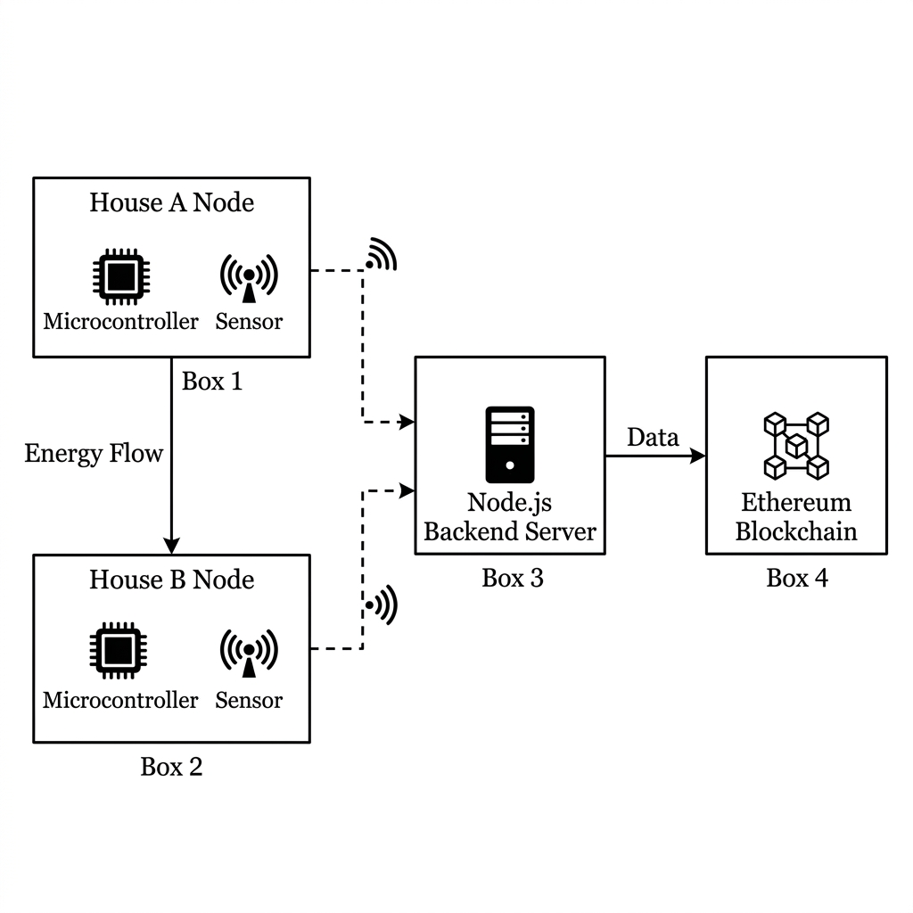

# ⚡ Smart Microgrid — Peer-to-Peer (P2P) Energy Trading System

> **A decentralized renewable energy sharing platform combining IoT sensors, Smart Contracts on Ethereum, AI-powered load forecasting, and a real-time web dashboard.**

[](https://github.com/AfnanAbdullah1)
[](LICENSE)
[](https://nodejs.org)
[](https://soliditylang.org)
[](https://tensorflow.org)
[](https://espressif.com)
[](https://trufflesuite.com/ganache/)

---

## 📌 What is This Project?

In traditional electricity grids, homes with solar panels sell extra energy back to the power company at low prices, while neighbors buy energy at high retail prices.

This project builds a **direct peer-to-peer (P2P) microgrid**:
- **House A** produces solar energy. When it consumes less than 1 Watt, an automatic relay switches ON and sends the excess power directly to **House B**.
- Every single unit of energy shared between the houses is **recorded on an Ethereum blockchain smart contract**, creating a permanent, tamper-proof trade ledger.
- An **AI LSTM neural network** predicts future power usage to prevent shortages.
- A **live web dashboard** lets users watch real-time energy flow, voltage, current, and blockchain transactions as they happen.

---

## 🖼️ Architecture & Visuals

### System Flow Diagram


```
┌─────────────────┐             ┌─────────────────┐
│     HOUSE A     │             │     HOUSE B     │
│  (Solar + PZEM) │             │   (Load + PZEM) │
└────────┬────────┘             └────────┬────────┘
         │                               │
         │ (Relay transfers power)       │
         └───────────────►───────────────┘
                 │               │
      500ms WiFi │               │ 500ms WiFi
      Telemetry  │               │ Telemetry
                 ▼               ▼
         ┌───────────────────────────────┐
         │       Node.js Backend         │
         │      (Express Port 3000)      │
         └───────┬───────────────┬───────┘
                 │               │
    HTTP /predict│               │ Web3.js JSON-RPC
                 ▼               ▼
      ┌────────────────────┐   ┌────────────────────┐
      │   AI ML Server     │   │ Ganache Blockchain │
      │  (LSTM Port 5000)  │   │  (Smart Contract)  │
      └────────────────────┘   └────────────────────┘
```

---

## ✨ Key Features

- **⚡ Automatic Power Routing:** Hardware relay switches dynamically based on live power demand. If House A uses less than 1W, power flows to House B automatically.
- **⛓️ Immutable Blockchain Ledger:** Smart contract written in Solidity (0.8.20) records buyer address, seller address, power (W), energy (Wh), and timestamp.
- **🤖 AI Load Forecasting:** Deep learning LSTM model predicts energy demand for the next hour to optimize sharing.
- **📊 Real-Time Web Dashboard:** Built with HTML5, CSS3, Chart.js, and Feather icons. Shows live gauges, interactive power animations, and the latest blockchain blocks.
- **🛡️ Failsafe Watchdog:** ESP32 controllers include a safety disconnect: if WiFi or backend connection drops for > 15 seconds, the transfer relay automatically opens to prevent faults.
- **🌐 Remote Monitoring Support:** Pre-configured with Ngrok tunnel support so live telemetry can be monitored over the internet.

---

## 🛠️ Tech Stack & Hardware

### Software Stack
| Layer | Technologies Used | Purpose |
|---|---|---|
| **Blockchain** | Solidity 0.8.20, Hardhat, Ganache, Web3.js | Smart contract execution & local Ethereum network |
| **Backend** | Node.js, Express.js, CORS, Dotenv | REST API, data aggregation, blockchain bridge |
| **Frontend** | HTML5, CSS3 Glassmorphism, Chart.js | Real-time monitoring web dashboard |
| **Machine Learning** | Python 3, TensorFlow / Keras (LSTM), Flask, Pandas, Scikit-learn | Energy load forecasting microservice |
| **Firmware** | C++ / Arduino Framework, PZEM004Tv30, ArduinoJson | ESP32 edge control & sensor telemetry |

### Hardware Bill of Materials
| Component | Quantity | Purpose in Prototype |
|---|---|---|
| **ESP32 Dev Board (30-pin)** | 2 | Main microcontrollers for House A and House B |
| **PZEM-004T v3.0 Sensor** | 2 | Measures AC Voltage, Current, Active Power, Energy & Frequency |
| **5V Relay Module (Active-LOW)** | 1 | Connects to GPIO 27; physically switches power line |
| **HOPE H201 Inverter (12V → 220V)** | 1 | Converts DC solar simulator voltage to 220V AC output |
| **12V 1A DC Power Supply** | 1 | Simulates solar panel energy generation |
| **1602A LCD + I2C Backpack** | 1 | Real-time physical display on House A (GPIO 21/22) |
| **LM2596 Buck Converters** | 2 | Steps down 12V DC to 5V DC to power both ESP32s |
| **AC Loads** | 2 | Bulbs / small appliance loads representing household demand |

---

## 📁 Repository Structure

```text
.
├── backend/                  # Node.js Express server & Web Dashboard
│   ├── contracts/            # ABI of compiled EnergyTrading smart contract
│   ├── data/                 # JSON transaction history & sensor log samples
│   ├── public/               # Web dashboard (index.html, styles, charts)
│   ├── .env.example          # Environment variables template
│   ├── package.json          # Node dependencies
│   ├── server.js             # Main server logic & Web3.js integration
│   └── test-api.js           # Automated API integration tests
│
├── blockchain/               # Ethereum Smart Contract workspace (Hardhat)
│   ├── contracts/            # Solidity source code (EnergyTrading.sol)
│   ├── deployments/          # Saved Ganache deployment addresses
│   ├── scripts/              # Contract deployment script (deploy.js)
│   ├── test/                 # Hardhat unit tests (EnergyTrading.test.js)
│   ├── hardhat.config.js     # Hardhat network & compiler configuration
│   └── package.json          # Hardhat & Web3 dependencies
│
├── ml-model/                 # Python AI Forecasting Microservice
│   ├── models/               # Trained LSTM model (.keras), scaler & metadata
│   ├── generate_data.py      # Microgrid data generator
│   ├── predict_server.py     # Flask API server serving predictions on port 5000
│   ├── requirements.txt      # Python dependencies
│   └── train_model.py        # Model training pipeline
│
├── firmware/                 # ESP32 C++ sketches for Arduino IDE
│   ├── house_a_controller/   # House A firmware (PZEM reading + Relay control)
│   ├── house_b_controller/   # House B firmware (PZEM reading + consumption tracking)
│   ├── house_a_test/         # Offline diagnostic sketch for House A
│   ├── house_b_test/         # Offline diagnostic sketch for House B
│   └── secrets.h.template    # WiFi and Server credentials template
│
├── hardware/                 # Schematics, pinouts, and wiring documentation
│   └── COMPLETE_WIRING_DIAGRAM.md
│
├── docs/                     # Guides, Urdu guides, testing notes, and LaTeX Report
│   ├── LaTeX_Report/         # Full academic thesis in LaTeX (chapters 1–8)
│   ├── BLOCKCHAIN_SETUP.md   # Detailed Ganache setup instructions
│   ├── NGROK_SETUP_GUIDE.md  # Public tunnel setup guide
│   └── QUICK_START.md        # Fast setup instructions
│
├── Images/                   # System diagrams, schematics, and UI previews
├── Poster/                   # Presentation posters and exhibition media
├── Thesis_Report/            # Final academic thesis documents (DOCX & PDF)
├── HOW_TO_START.md           # Full master startup documentation
├── LICENSE                   # MIT Open Source License
└── README.md                 # Project README
```

---

## 🚀 Step-by-Step Setup Guide

### 1. Prerequisites
Install these on your computer:
- **Node.js** (v18 or higher) — [Download](https://nodejs.org)
- **Python** (v3.9 to 3.11) — [Download](https://python.org)
- **Ganache** — [Download Truffle Ganache](https://trufflesuite.com/ganache/)
- **Arduino IDE** (2.x) — [Download](https://arduino.cc)

---

### 2. Blockchain Setup (Ganache + Smart Contract)

1. Open **Ganache**, select **"New Workspace (Ethereum)"**.
2. Set **Port** to `7545` and **Network ID** to `1337`. Click **Save Workspace**.
3. Copy the **Private Key** of Account #1 (click the key icon next to the first address).
4. Open a terminal in `blockchain/` and install dependencies:
   ```bash
   cd blockchain
   npm install
   ```
5. Deploy the smart contract to Ganache:
   ```bash
   npx hardhat run scripts/deploy.js --network ganache
   ```
   > This automatically copies the contract ABI and address to the `backend/` folder!

---

### 3. AI Prediction Server Setup

Open a new terminal window:
```bash
cd ml-model
pip install -r requirements.txt
python predict_server.py
```
*The AI server will start on `http://localhost:5000`.*

---

### 4. Backend Server & Dashboard Setup

Open a new terminal window:
```bash
cd backend
npm install
```

Copy the environment file:
```bash
cp .env.example .env
```
*(Make sure `CONTRACT_ADDRESS` and `DEPLOYER_PRIVATE_KEY` match your Ganache deployment).*

Start the backend:
```bash
npm start
```

Now open your browser and visit:
👉 **`http://localhost:3000`** to view the live dashboard!

---

### 5. ESP32 Firmware Setup (Hardware)

1. Open **Arduino IDE**.
2. Install the required libraries via Arduino Library Manager:
   - `PZEM004Tv30`
   - `LiquidCrystal_I2C`
   - `ArduinoJson`
3. Configure credentials:
   - Go to `firmware/house_a_controller/`
   - Create `secrets.h` from `secrets.h.template`:
     ```c
     #define WIFI_SSID "Your_WiFi_Name"
     #define WIFI_PASSWORD "Your_WiFi_Password"
     #define SERVER_IP "192.168.1.XX" // Your computer's local IP address
     ```
   - Do the same for `firmware/house_b_controller/secrets.h`.
4. Connect each ESP32 via USB and upload:
   - Upload `house_a_controller.ino` to **House A ESP32**.
   - Upload `house_b_controller.ino` to **House B ESP32**.

---

## 📡 REST API Reference

| Method | Endpoint | Description |
|---|---|---|
| `GET` | `/api/live` | Returns live sensor values (power, voltage, relay state) for both houses |
| `POST` | `/api/live` | Receives live sensor telemetry stream from ESP32s (every 500ms) |
| `POST` | `/api/transaction` | Records an energy trade on the Ganache blockchain smart contract |
| `GET` | `/api/transactions` | Retrieves confirmed trade transactions from the blockchain ledger |
| `GET` | `/api/contract/stats` | Returns total trade count, cumulative energy traded, and contract address |
| `GET` | `/api/ai/prediction` | Fetches next-hour energy consumption predictions from the AI server |
| `POST` | `/api/relay/manual` | Manually toggles relay state for testing and demonstration |

---

## 💡 How the Automatic Trading Works

```
                     ┌────────────────────────┐
                     │ Read House A Power (W) │
                     └───────────┬────────────┘
                                 │
                     ┌───────────▼────────────┐
                     │ Is Power < 1.0 Watt ?  │
                     └─────┬────────────┬─────┘
                           │            │
                     YES   │            │  NO
                           ▼            ▼
             ┌──────────────────┐  ┌──────────────────┐
             │ Relay = ON (LOW) │  │ Relay = OFF      │
             │ Share to House B │  │ House A uses own │
             └─────────┬────────┘  └────────┬─────────┘
                       │                    │
                       └──────────┬─────────┘
                                  ▼
             ┌────────────────────────────────────────┐
             │  Send 500ms Telemetry to /api/live     │
             │  Send 60s Batch to /api/transaction   │
             │  Record to Ethereum Smart Contract     │
             └────────────────────────────────────────┘
```

---

## 📄 Complete Documentation

For in-depth explanations, diagrams, and hardware guides, check the documentation folders:
- 📖 [Master Startup Guide (HOW_TO_START.md)](HOW_TO_START.md)
- 🔌 [Complete Hardware Wiring Diagram](hardware/COMPLETE_WIRING_DIAGRAM.md)
- ⛓️ [Blockchain Setup & Ganache Guide](docs/BLOCKCHAIN_SETUP.md)
- 🌐 [Ngrok Public Tunnel Guide](docs/NGROK_SETUP_GUIDE.md)
- 🧪 [Step-by-Step Testing Guide](docs/SIMPLE_TEST_GUIDE.md)
- 🎓 [Academic LaTeX Thesis Report](docs/LaTeX_Report/main.tex)

---

## 👨‍💻 Author

Developed and Maintained by:

**Afnan Abdullah**  
- **GitHub:** [@AfnanAbdullah1](https://github.com/AfnanAbdullah1)

---

## 📜 License

This project is open-source under the [MIT License](LICENSE). Feel free to use, modify, and distribute with attribution.
