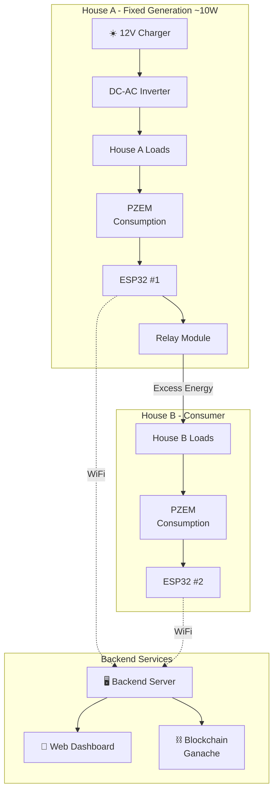
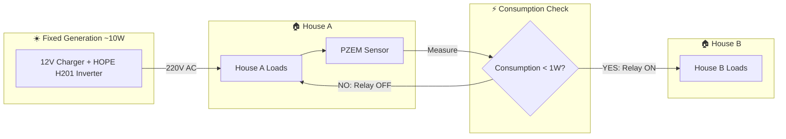
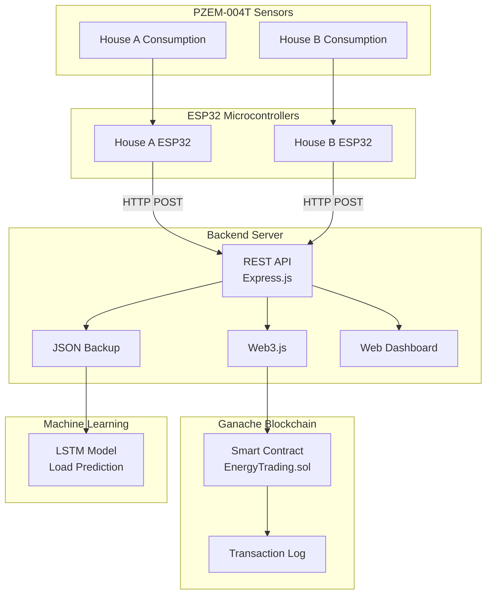
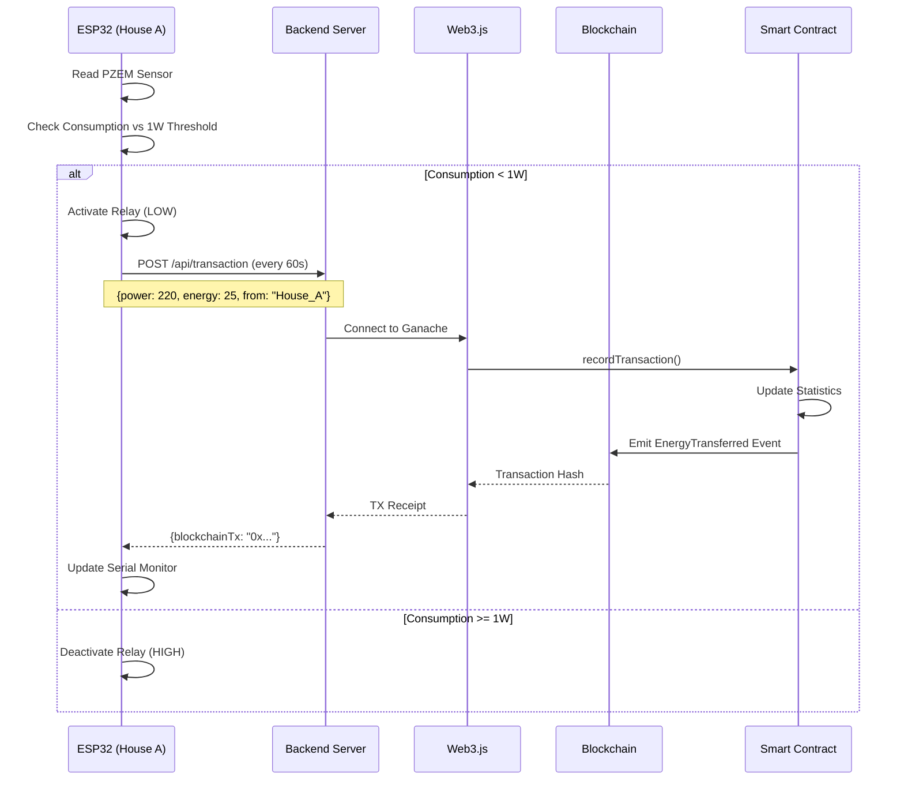
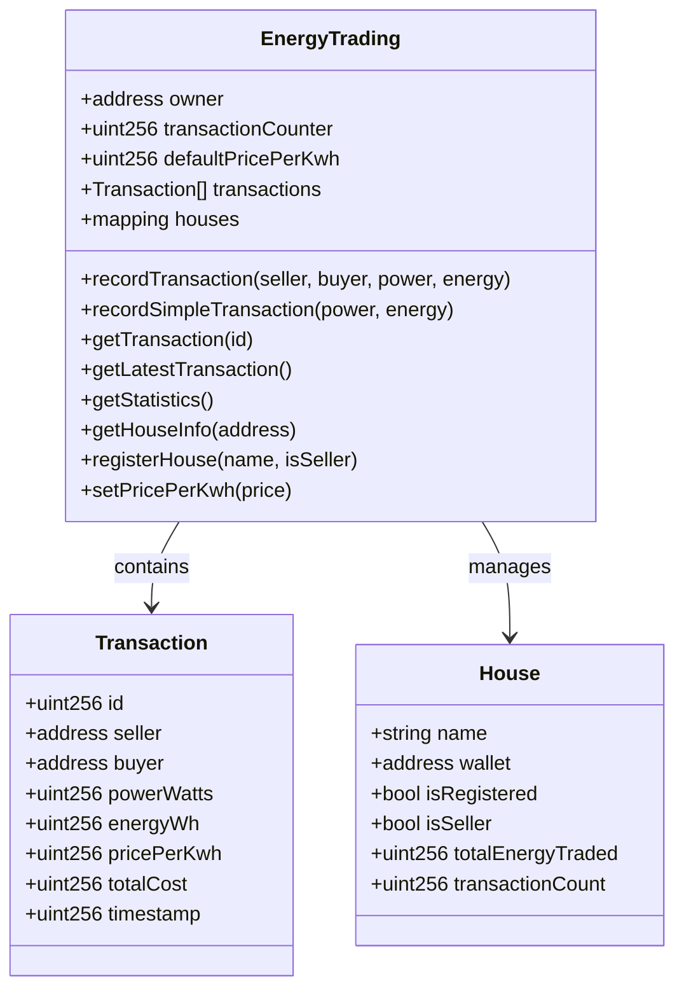
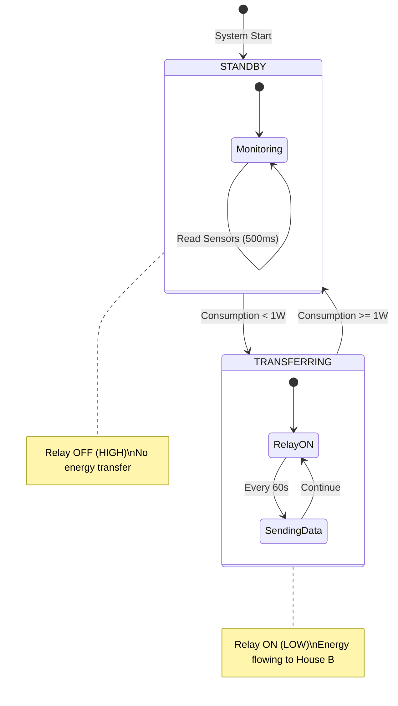
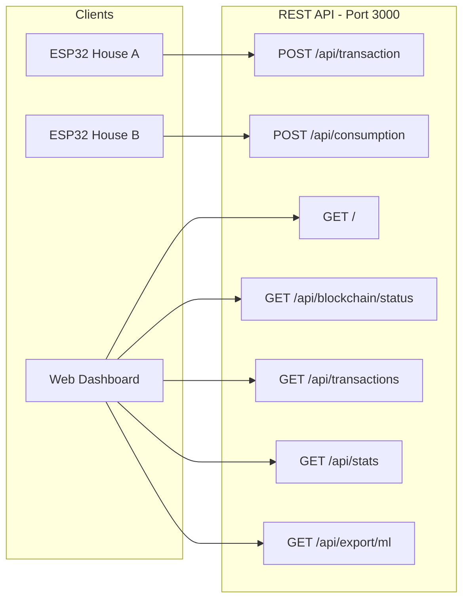
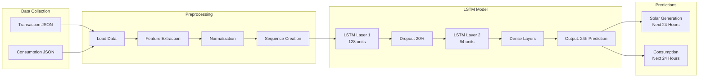
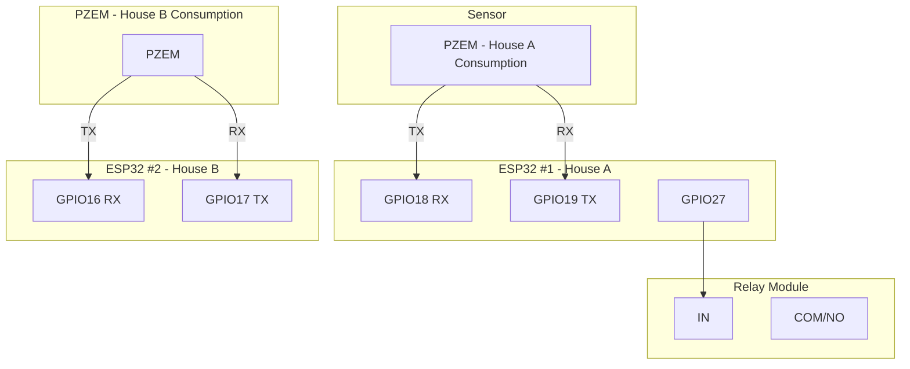

# Smart Microgrid P2P Energy Trading System
## Complete Project Overview & Flow Documentation

---

## 1. System Overview

The Smart Microgrid P2P Energy Trading System enables **peer-to-peer energy trading** between a solar producer (House A) and a consumer (House B), with all transactions recorded on an **immutable blockchain ledger**.



---

## 2. Energy Flow Diagram

Shows how electricity flows between houses based on solar production.



---

## 3. Data Flow Architecture



---

## 4. Transaction Recording Flow

Step-by-step flow of how energy transactions are recorded on blockchain.



---

## 5. Smart Contract Functions



---

## 6. Relay Control Logic



---

## 7. API Endpoints



| Endpoint | Method | Description |
|----------|--------|-------------|
| `/` | GET | Server health & blockchain status |
| `/api/blockchain/status` | GET | Detailed blockchain info |
| `/api/transaction` | POST | Record energy transaction |
| `/api/consumption` | POST | Record House B data |
| `/api/transactions` | GET | List all transactions |
| `/api/stats` | GET | Energy statistics |
| `/api/export/ml` | GET | Export for ML training |

---

## 8. Local Web Dashboard

**URL:** `http://localhost:3000`

The web dashboard is served by the backend server and displays:
- Live voltage, current, power for House A and House B
- Relay status (ON/OFF)
- Transaction count and blockchain status
- Recent transaction history with blockchain hashes

Data is streamed via the `/api/live` endpoint every 500ms from both ESP32s.

---

## 9. ML Prediction Pipeline



---

## 10. Hardware Wiring Summary



---

## 11. Project File Structure

```
📁 Smart-Microgrid-P2P/
├── 📁 blockchain/           ← Ethereum Smart Contract
│   ├── 📁 contracts/
│   │   └── 📄 EnergyTrading.sol
│   ├── 📁 scripts/
│   │   └── 📄 deploy.js
│   ├── 📁 test/
│   │   └── 📄 EnergyTrading.test.js
│   ├── 📄 hardhat.config.js
│   └── 📄 package.json
│
├── 📁 backend/              ← Node.js API Server
│   ├── 📄 server.js         (Web3.js + Express)
│   ├── 📄 package.json
│   ├── 📄 .env.example
│   └── 📄 test-api.js
│
├── 📁 firmware/             ← ESP32 Arduino Code
│   ├── 📄 secrets.h.template
│   ├── 📁 house_a_controller/
│   │   └── 📄 house_a_controller.ino
│   └── 📁 house_b_controller/
│       └── 📄 house_b_controller.ino
│
├── 📁 ml-model/             ← AI Load Prediction
│   ├── 📄 train_model.py
│   └── 📄 requirements.txt
│
├── 📁 hardware/             ← Wiring Diagrams
│   └── 📄 COMPLETE_WIRING_DIAGRAM.md
│
├── 📁 docs/                 ← Documentation
│   ├── 📄 BLOCKCHAIN_SETUP.md
│   ├── 📄 NGROK_SETUP_GUIDE.md
│   └── 📄 PROJECT_FLOW.md  (This file)
│
├── 📄 README.md
└── 📄 QUICK_START.md
```

---

## 12. Technology Stack

| Layer | Technology | Purpose |
|-------|------------|---------|
| **Hardware** | ESP32, PZEM-004T | Sensing & Control |
| **Firmware** | Arduino C++ | Embedded Logic |
| **Communication** | WiFi, HTTP | Data Transfer |
| **Backend** | Node.js, Express | API Server |
| **Blockchain** | Ganache, Solidity | Transaction Ledger |
| **Blockchain API** | Web3.js | Smart Contract Calls |
| **Dashboard** | Local Web (HTML/JS) | Real-time Monitoring |
| **Machine Learning** | TensorFlow, LSTM | Load Prediction |

---

## 13. Quick Reference Commands

```powershell
# Start Blockchain
cd blockchain && npx hardhat run scripts/deploy.js --network ganache

# Start Server
cd backend && npm start

# Run Tests
cd blockchain && npm test

# Test API
cd backend && node test-api.js
```

---

*Smart Microgrid P2P Energy Trading System - January 2026*
