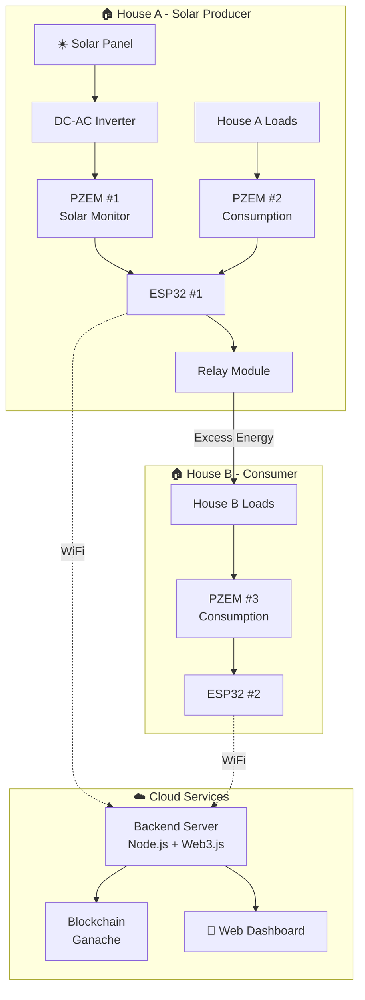
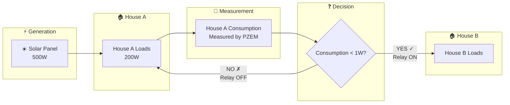
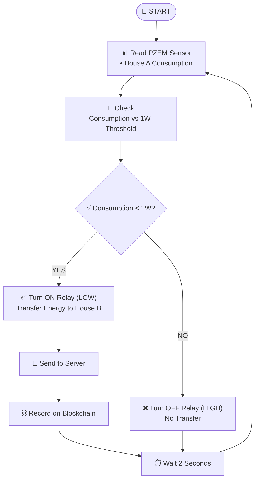
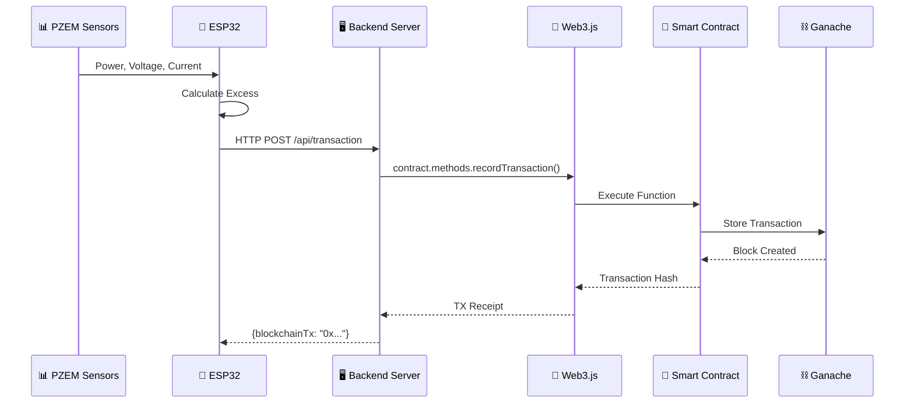
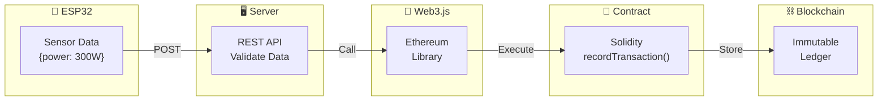

# Smart Microgrid P2P Energy Trading System
## Final Year Project - BS Electrical Engineering

---

## Project Summary

This project implements a **Blockchain-based Peer-to-Peer (P2P) Energy Trading System** for smart microgrids. The system enables automated energy sharing between a solar-producing household and a neighboring consumer, with all transactions recorded on an immutable blockchain ledger. Additionally, an AI-based load prediction model forecasts future energy generation and consumption patterns.

---

## Problem Statement

Traditional power grids operate on a centralized model where consumers can only purchase electricity from utility providers. With the rise of distributed energy resources (solar panels, home batteries), prosumers (producer-consumers) often generate excess energy that goes unutilized. Current solutions lack:

- **Transparent peer-to-peer trading mechanisms**
- **Immutable transaction records**
- **Real-time monitoring and automation**
- **Predictive analytics for load management**

---

## Objectives

1. Design and implement a P2P energy trading system between two households
2. Develop automatic excess energy detection and transfer mechanism
3. Integrate blockchain technology for transparent transaction recording
4. Create a local web dashboard for real-time monitoring
5. Implement AI-based load prediction for optimized energy management

---

## Methodology

### Hardware Implementation
- **Energy Monitoring**: PZEM-004T sensors measure voltage, current, power, and energy
- **Microcontrollers**: ESP32 modules for data acquisition and relay control
- **Automatic Transfer**: Relay module controlled based on excess energy availability

### Software Implementation
- **Smart Contract**: Solidity-based contract on Ethereum blockchain (Ganache)
- **Backend Server**: Node.js with Web3.js for blockchain interaction
- **Web Dashboard**: Local real-time dashboard at localhost:3000
- **AI Model**: LSTM neural network for 24-hour load prediction

---

## System Architecture

```
┌─────────────────────────────────────────────────────────────────────┐
│                        SMART MICROGRID SYSTEM                        │
├─────────────────────────────────────────────────────────────────────┤
│                                                                      │
│   ┌───────────────┐                      ┌───────────────┐          │
│   │   HOUSE A     │   Excess Energy      │   HOUSE B     │          │
│   │   (Producer)  │ ──────────────────▶  │  (Consumer)   │          │
│   │   Solar Panel │      via Relay       │               │          │
│   └───────┬───────┘                      └───────┬───────┘          │
│           │                                      │                   │
│           │ WiFi                                 │ WiFi              │
│           ▼                                      ▼                   │
│   ┌─────────────────────────────────────────────────────┐           │
│   │              BACKEND SERVER (Node.js)                │           │
│   │                    + Web3.js                         │           │
│   └─────────────────────────┬───────────────────────────┘           │
│                             │                                        │
│                             ▼                                        │
│   ┌─────────────────────────────────────────────────────┐           │
│   │         BLOCKCHAIN (Ganache - Ethereum)              │           │
│   │              Smart Contract Layer                    │           │
│   └─────────────────────────────────────────────────────┘           │
│                                                                      │
└─────────────────────────────────────────────────────────────────────┘
```

---

## Key Features

| Feature | Description |
|---------|-------------|
| **Automatic Energy Transfer** | Relay activates when House A consumption < 1W threshold |
| **Blockchain Recording** | Every transaction stored with cryptographic hash |
| **Real-time Monitoring** | Local web dashboard displays live power readings |
| **AI Prediction** | LSTM model forecasts next 24 hours of generation/consumption |
| **Immutable Ledger** | Transaction history cannot be altered or deleted |

---

## How It Works

**Step 1: Energy Generation**  
House A has a solar panel that generates electricity. The PZEM sensor continuously measures how much power is being produced.

**Step 2: Consumption Monitoring**  
Another sensor monitors how much power House A is consuming for its own appliances (lights, fans, etc.).

**Step 3: Excess Calculation**  
The ESP32 microcontroller calculates: **Excess Power = Solar Production - House A Consumption**

**Step 4: Automatic Transfer Decision**  
- If consumption **< 1W** → Relay turns ON → Excess energy flows to House B
- If consumption **≥ 1W** → Relay turns OFF → No transfer

**Step 5: Blockchain Recording**  
Every 60 seconds, the transaction data is sent to the backend server, which records it on the blockchain with a unique cryptographic hash. This creates a permanent, tamper-proof record.

**Step 6: Real-time Monitoring**  
Both houses stream live telemetry to the backend server, which serves a real-time web dashboard at `http://localhost:3000` showing voltage, current, power, relay status, and transaction history.

**Step 7: AI Prediction**  
The collected data is used to train an LSTM neural network that predicts the next 24 hours of solar generation and energy consumption, enabling better energy planning.

---

### Simple Example

> 🌞 **Scenario**: House A's solar panel produces **500W**. House A uses **200W** for its own needs.
> 
> ⚡ **Calculation**: Excess = 500W - 200W = **300W**
> 
> ✅ **Action**: Since House A consumption is only 0.5W (< 1W threshold), the relay activates and **excess energy flows to House B**.
> 
> ⛓️ **Record**: Transaction recorded on blockchain: *"House A transferred 300W to House B at 2:30 PM"*

---

## Flow Diagrams

### 1. System Architecture



---

### 2. Energy Flow Diagram



---

### 3. Decision Flowchart



---

### 4. Data Flow Diagram



---

### 5. Blockchain Transaction Flow



---

## Hardware Components

| Component | Quantity | Purpose |
|-----------|----------|---------|
| ESP32 Microcontroller | 2 | Data acquisition & control |
| PZEM-004T Sensor | 2 | Energy measurement |
| Relay Module | 1 | Energy transfer switching |
| DC-AC Inverter | 1 | Solar DC to AC conversion |
| Solar Panel | 1 | Energy generation |

---

## Software Technologies

| Layer | Technology |
|-------|------------|
| Embedded | Arduino (C++) |
| Backend | Node.js, Express.js |
| Blockchain | Solidity, Hardhat, Ganache |
| Blockchain API | Web3.js |
| Dashboard | Local Web (HTML/JS) |
| Machine Learning | TensorFlow, Keras (LSTM) |

---

## Expected Outcomes

1. **Functional prototype** demonstrating P2P energy trading between two houses
2. **Blockchain ledger** with immutable transaction records
3. **Web dashboard** for real-time monitoring and visualization
4. **AI model** capable of predicting energy patterns with >85% accuracy
5. **Complete documentation** including wiring diagrams and user guides

---

## Project Scope

- **In Scope**: Two-house prototype, local blockchain, mobile monitoring, load prediction
- **Out of Scope**: Grid integration, billing/payment systems, multi-house scaling

---

## Timeline

| Phase | Duration | Activities |
|-------|----------|------------|
| Phase 1 | Week 1-2 | Hardware assembly & testing |
| Phase 2 | Week 3-4 | Firmware & blockchain development |
| Phase 3 | Week 5-6 | Data collection & AI training |
| Phase 4 | Week 7-8 | Testing, documentation & demo |

---

## Conclusion

This project demonstrates the feasibility of blockchain-based P2P energy trading at a household level. By combining IoT sensors, smart contracts, and machine learning, the system provides a transparent, automated, and intelligent solution for distributed energy management in smart microgrids.

---

**Submitted by:** [Student Name]  
**Registration No:** [Registration Number]  
**Supervisor:** [Supervisor Name]  
**Department:** Electrical Engineering  
**Date:** January 2026
